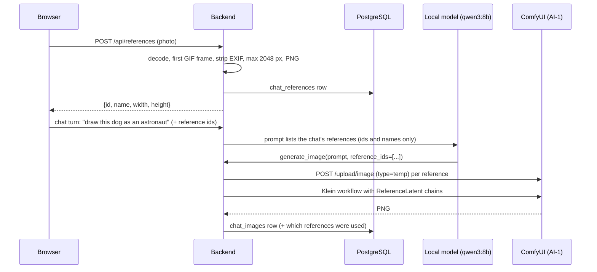

# Reference images for image generation: implementation plan

Status: **phases 1–3 released in 1.10.0, phase 4 (captions) in 1.11.0** (2026-11-23).

**Live test on AI-1** (synthetic shapes, 1024², 8 steps, outside reservations):

| References | Time | Result |
|---|---|---|
| 1 at 1 MP | 35 s (incl. cold load) | follows shape and colour |
| 2 at 1 MP | 41 s | both objects as in the references |
| 4 at 0.5 MP | 42 s | colours kept, but every shape came out as a disc |

So 1 or 2 references is the default the tool hint recommends; 3 or 4 are allowed, and the
result is flagged as lower fidelity, as the AI-1 agent advised. The AI-1 agent has the API
graphs for a fuller benchmark (warm times, peak VRAM, 4 × 1 MP), which it runs only with the
owner's OK because it evicts the chat model.

**Benchmark** (owner's OK, 2026-11-23; warm, 2 runs each; peak VRAM sampled every 0.5 s as
`vram_total - (vram_free - torch_vram_free)`):

| Config | Warm time | Peak VRAM |
|---|---|---|
| no references | ~15 s | 8.1 GiB |
| 1 × 1 MP | 19 s | 9.5 GiB |
| 2 × 1 MP | ~30 s | 9.1 GiB |
| 4 × 0.5 MP | ~30 s | 9.1 GiB |
| 4 × 1 MP | ~57 s | 7.6 GiB (peak probably missed) |

4 × 1 MP takes twice as long as 4 × 0.5 MP with no visible gain, so the 2 MP total cap stays.
`qwen3:8b` was back fully on the GPU after every run.

**Phase 3 (frontend):** the paperclip takes PNG, JPEG, GIF and WebP next to text files. A photo
is uploaded when the message is sent, and the model gets a marker
`<reference-image id="…" name="…" />` in place of the picture. After a reload the marker shows
as a thumbnail in the user's message; click to enlarge or delete it. The image card lists the
references it used, and the PDF prints them as thumbnails (a deleted one by name). Checked in a
browser against a fake backend, desktop and phone.

**Phase 4 (captions, 1.11.0):** with two people's photos, only one came out and the other was
generic. Klein follows the text, and the chat model, which can't see the photos, wrote "two
pirates" or "his friend". Tested on AI-1 with the same two photos and seed:

| Prompt | Result |
|---|---|
| generic ("two pirates in a pub") | neither clearly |
| generic + "the subject from image 1 and the subject from image 2" | one, the other generic |
| names by image number ("Davy Jones from image 2") | one, the other generic |
| visual description by image number | both |
| generic + qwen3-vl captions ("Image 2 shows: a creature with … tentacle-like appendages") | both |

So each photo is captioned once by `qwen3-vl:8b` during its first image job and the caption is
appended to the prompt. qwen3-vl reasons even with `think: false` and spent all 100 tokens on
it; a prefilled empty `<think></think>` fixes that (6 s load, 3 s per photo). Announced to the
AI-1 agent, which keeps qwen3-vl:8b on its keep-list.
Branch: `reference-images`, merged into `dev`, then `dev` into `main`.

## Goal

The user attaches photos of a person, an animal or an object (PNG, JPEG, GIF or WebP) and asks
for an image that looks like them, e.g. "draw this dog as an astronaut in watercolour". The
generated image should follow the references' shape, colours and look; faces should be
recognisable.

## Decisions (owner, 2026-11-23)

| Question | Decision |
|---|---|
| Model | **FLUX.2 Klein 4B** for every image with references: the only model on AI-1 with reference conditioning. |
| References per image | **Up to 4**, with a total reference area of about **2 MP**, as the AI-1 agent advised: 1 or 2 references at 1 MP each, 3 or 4 at about 0.5 MP each. |
| Claude (hybrid mode) | The chat's **Docs** checkbox also lets Claude **see** the reference images in a handed-over turn; otherwise Claude only gets their names. |
| Describing photos with a vision model (`qwen3-vl:8b`) | **Later**, as an option (phase 4). |
| Workflow | Plan first, on this branch. |

## What AI-1 offers (checked 2026-11-23, read-only)

The AI-1 agent's own workflows (`02_klein_keyframe_refs`, `03_klein_edit_fix`,
`04_klein_face_detail`) condition FLUX.2 Klein on reference photos. For each photo they run:

```text
LoadImage → ImageScaleToTotalPixels (lanczos, 1.0 MP, multiple of 16) → VAEEncode
  → ReferenceLatent on the positive conditioning
  → ReferenceLatent on the zeroed negative conditioning
```

They chain up to 5 references per image. The rest is the text-to-image Klein workflow already in
the app: CFGGuider at 1.0, euler, the Flux2Scheduler, RandomNoise and EmptyFlux2LatentImage.

ComfyUI accepts uploads with `POST /upload/image` (multipart, with a `type` field: input, temp
or output). `LoadImage` takes uploaded images.

**The AI-1 agent's answers (2026-11-23):**

- **Temp uploads:** `type=temp` plus `LoadImage("name.png [temp]")` works on AI-1. Use unique
  names; a repeated name is renamed, not overwritten.
- **Temp is not cleared soon.** ComfyUI empties its temp folder only at startup (and not in every
  configuration), and restarts are rare.
- **Temp files are readable by any LAN host** that reaches :8188, via `/view?type=temp`.
- **The same is true of the PNGs the app already generates:** `PreviewImage` writes to temp. So
  "no lasting copy on AI-1" holds only until the next restart, not right away. Two fixes:
  - Outputs: `SaveImageWebsocket` (installed) sends the PNG over ComfyUI's websocket without
    writing a file. This needs the `websockets` package declared, which is installed today only
    as a dependency of a dependency, so it needs the owner's approval.
  - Inputs: there is no node for inline images, so reference photos must be uploaded as files.
    Never `input/`, which is permanent by design. **The owner approved a purge:** a cron job on
    AI-1 deletes temp files older than 60 min, every 15 min, so a temp file lives at most about
    75 min.
  - **Constraint on the app:** upload a job's references right before queueing it, with names
    unique to that job, never ahead of time and never reused across jobs. A job and its uploads
    must finish within 60 min of the upload.
- **The websocket switch** (AI-1 agent, later the same day), for when it is built:
  - Per job, open `ws://…:8188/ws?clientId=ai-assistant-ui-<job>` *before* queueing, and queue
    with the same `client_id`. `SaveImageWebsocket` sends the PNG only to the client that queued
    the prompt, and a fast job could otherwise finish unseen.
  - The busy check must treat every `ai-assistant-ui-*` id as ours.
  - After the job, `POST /history {"delete": [prompt_id]}`, so the prompt text and the
    reference file names don't stay in ComfyUI's memory.
  - Nothing on AI-1 keys on the exact client id, and its reservation check ignores client ids.
- **Load:** each reference at about 1 MP adds about as many image tokens as the target itself.
  4 refs at 1 MP is about 5x the sequence length, and much more attention work. Hence the cap of
  about 2 MP in total. Plain Klein at 1 MP / 8 steps takes about 15 s warm on AI-1. The AI-1 agent
  offered to benchmark 1, 2 and 4 references (time, peak VRAM) once the workflow graph exists.

**What to expect:** similar style, colours, shape and objects. Faces will be recognisable but not
exact: AI-1 has no dedicated face-identity model (such as PuLID or InstantID). Adding one is the
AI-1 agent's and the owner's decision.

## Design



### Backend

1. **Storage** (`app/references/`, new): a `chat_references` table with id, thread, user, file
   name, PNG bytes, width, height, created and deleted. A reference is deleted with its chat, and
   can be deleted on its own (bytes removed, tombstone kept, as for generated images).
2. **Normalising uploads:**
   - accept PNG, JPEG, GIF and WebP, up to 20 MB;
   - decode with Pillow (already installed) and take a GIF's first frame;
   - apply the EXIF orientation, then drop all metadata, so phone photos lose their GPS location;
   - convert to RGB, scale to at most 2048 px on the long side, and store as PNG;
   - refuse anything that doesn't decode.
3. **Endpoints:**
   - `POST /api/references` (multipart, with the chat id);
   - `GET /api/references/{id}` (PNG; 404 if not yours, 410 once deleted);
   - `DELETE /api/references/{id}`;
   - `GET /api/chats/{id}/references`, listing a chat's references.

   Ownership is checked as for chats and images.
4. **The model's view:** a block in the system prompt lists the chat's references (id, file name,
   size), like attached documents. The local model never receives the image data, since
   `qwen3:8b` can't see images.
5. **Tool:** `generate_image` gains `reference_ids` (up to 4). With references, the model is
   always FLUX.2 Klein, whatever was asked. Unknown, deleted or foreign ids give a clear error.
   The prompt hint tells the model to pass the ids of the photos the user means, and to describe
   only what should change.
6. **Workflow** (`app/images/comfyui.py`):
   - Each reference is uploaded to ComfyUI with `type=temp`, so no lasting copy stays on AI-1,
     the same as for generated images. Whether `LoadImage` can read from the temp folder (an
     annotated name, `name.png [temp]`) is checked first with one tiny test image. If it can't,
     upload to `input` under a per-job subfolder and ask the AI-1 agent how to clean it up.
   - Then the ReferenceLatent chain above, one block per reference, ahead of the existing Klein
     sampling.
   - The catalog check also requires `LoadImage`, `ImageScaleToTotalPixels`, `VAEEncode` and
     `ReferenceLatent`.
7. **Records and display:** `chat_images` stores which references an image used, so the card can
   show them. The PDF export prints small thumbnails of the references under the image.
8. **Hybrid mode:** in a Claude turn, the reference block lists names only. With the chat's Docs
   permission, the references are also added to Claude's view of the turn as images, so Claude
   can write a better prompt. Generation always stays on AI-1.

### Frontend

1. **Attachments:** the paperclip accepts `image/png, image/jpeg, image/gif, image/webp` next to
   text documents. A small image adapter uploads to `/api/references` and shows a thumbnail chip
   in the composer, with its size and a remove button. Several photos per message are allowed,
   up to 4 per image.
2. **In the message:** the user's message shows the reference thumbnails; click one to enlarge.
3. **Image card:** "References: 🖼🖼" with small thumbnails under the prompt, for images generated
   with references.
4. **Proxy:** `app/api/references/[[...path]]/route.ts` passes POST, GET and DELETE through.
5. **Phones:** chips and thumbnails wrap, and the layout follows v1.9.3.

### GPU and the AI-1 agent

- References add one VAE encode per photo, at about 1 MP each, which is little next to sampling.
  The existing GPU hand-off and the reservation check apply unchanged.
- **Per our protocol (B4):** a new workflow on AI-1's ComfyUI is announced to the AI-1 agent
  before it goes live. Questions for it: temp uploads (point 6), and whether it would welcome a
  limit of 4 references at about 1 MP each.

### Privacy

- Photos of people stay on ai-2 and AI-1. ComfyUI gets them only in its temp folder. They stay
  there until the purge or a ComfyUI restart, and are readable from the LAN on :8188 in the
  meantime (see the AI-1 agent's answers above). Generated images: switch to
  `SaveImageWebsocket` so they never touch AI-1's disk.
- They go to Claude only when the chat's Docs box is ticked.
- EXIF metadata, including GPS location, is removed on upload.
- Deleting a reference, or its chat, removes the stored photo.
- If you use photos of real people, make sure they've agreed.

### Tests

- **Backend** (offline, with ComfyUI and Ollama mocked):
  - normalisation: PNG, JPEG with EXIF and orientation, animated GIF, WebP, too large, not an
    image, metadata gone;
  - storage and ownership, delete then 410, cascade on chat delete;
  - the workflow builder: a ReferenceLatent chain per reference, links valid, prompt text kept as a
    value;
  - upload calls; the tool (forcing Klein, more than 4 ids, unknown ids);
  - the prompt block; the Claude view with and without Docs.
- **Frontend:** the image adapter (accept list, upload, errors), composer chips, message
  thumbnails, and references on the image card.
- **Live, short:** one image with one reference and one with three, outside AI-1's reservations,
  after telling the AI-1 agent. Checked in a phone-sized browser too.

## Phases

| # | Work | Result |
|---|---|---|
| 1 | Check temp uploads on AI-1 with one tiny image; storage, normalisation and endpoints | References can be attached and stored |
| 2 | Reference workflow, `generate_image(reference_ids)`, prompt block, Claude view | Images generated with references |
| 3 | Frontend: image attachments, thumbnails, card, PDF thumbnails | Usable end to end |
| 4 | Describe references with `qwen3-vl:8b` to improve prompts (done in 1.11.0) | Every referenced subject comes out |
| 5 | Docs, CHANGELOG, runbook note, release 1.10.0, tell the AI-1 agent | Release |
