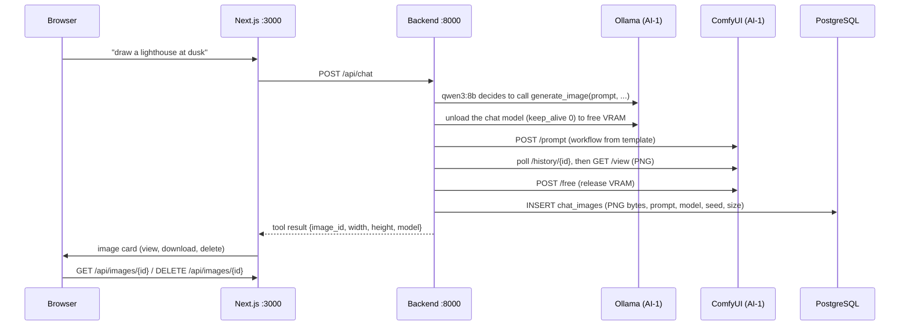

# Text-to-image (T2I): implementation plan

Status: **implemented on this branch** (option A: ComfyUI provider), not yet deployed. Target release: 1.8.0.

Both workflows were tested against AI-1's ComfyUI on 2026-11-21: z-image-turbo 56 s and
flux2-klein 35 s for 1024×1024, cold loads included. The Ollama provider (phase 4) and an
image-model picker in the header are not built yet.
Branch: `text-to-image`, merged into `dev`, then `dev` into `main`, as for earlier features.

## Goal

A user asks in the chat for a picture ("draw a lighthouse at dusk, watercolour").
The agent recognises the request, picks an image model from the ones AI-1 can run,
generates the image on AI-1's GPU, stores it, and shows it in the chat.

The user can:

- see the image in the conversation, live and after reloading the chat
- open it full size and download it as a PNG
- delete it permanently: the bytes are removed from the database, and the card
  in the chat shows "Image deleted" from then on

## What AI-1 offers today (checked 2026-11-21, read-only)

| Service | Image generation |
|---|---|
| Ollama 0.40.0 (:11434) | **No image models.** Only chat, vision and embedding models are installed. |
| ComfyUI 0.39.0 (:8188), RTX 3060 12 GB | **Yes.** Diffusion models present: `z_image_turbo` (int8 and Nunchaku int4), `flux-2-klein-4b`, `qwen_image_2.1` and `qwen_image_2.1_turbo`, with their text encoders and VAEs. Also used by AI-1's own image and video jobs. |

So "generate through Ollama" is not possible with what is installed now. The plan
puts image generation behind a small provider interface, with ComfyUI as the
first provider and Ollama as a second one for when Ollama image models are installed
(its `/api/tags` reports them with the `image` capability). Installing models on AI-1
belongs to the ai-1 agent and the user, not to this app.

## Design

### Backend (`backend/app/images/`, new package)

1. **Providers** (`providers/base.py`, `comfyui.py`, `ollama.py`)
   - `ImageProvider` interface: `list_models()`, `generate(prompt, model, width, height, seed, steps) -> PNG bytes`.
   - **ComfyUI:** submits a workflow built from a JSON template (`workflows/<model>.json`, exported
     from ComfyUI in API format), with only these filled in: prompt text, size, seed and steps.
     The model's text is never used as workflow JSON. It polls `/history/{prompt_id}` until done,
     with a timeout, and fetches the PNG via `/view`. The template ends in a
     preview node, which writes to ComfyUI's temp folder, not `SaveImage`, so no lasting copy stays
     on AI-1. That is part of "delete permanently". *Corrected in 1.9.4:* the temp folder is
     emptied only when ComfyUI restarts, and is readable from the LAN until then, so this did not
     hold. Since 1.9.4 the workflows end in `SaveImageWebsocket`, which sends the PNG over the
     websocket and writes no file.
   - **Ollama:** `POST /api/generate` with an image model, PNG returned in the response. Listed only
     when Ollama reports an `image`-capable model. Code and tests ship, but it stays unused until
     such a model exists.
   - Uses `httpx`, already installed. No new backend dependencies.
2. **Catalog** (`images.yaml`, like `models.yaml`): one entry per image model, with a name, provider,
   workflow template, default size and steps, and a one-line description for the agent. At startup
   (and on `list`) an entry is offered only if its files are present on ComfyUI
   (`GET /models/diffusion_models`) or the tag is on Ollama. Default model: `z-image-turbo`
   (8 steps, fits in 12 GB).
3. **GPU hand-off.** The 12 GB GPU holds either the chat model or an image model, not both. Before
   generating, the backend asks Ollama to unload the chat model (`keep_alive: 0`). Afterwards it
   asks ComfyUI to release VRAM (`POST /free`). One generation at a time, through an asyncio lock.
   The next chat reply pays a cold load of about 6 s.
4. **Storage** (`store.py`): table `chat_images`
   (`id UUID`, `thread_id → chat_threads ON DELETE CASCADE`, `user_id`, `prompt`, `model`, `seed`,
   `width`, `height`, `png BYTEA`, `created_at`). PNGs are about 1 to 2 MB at 1024². Deleting a chat
   deletes its images. Size is checked and the image is verified with Pillow, already installed via fpdf2.
5. **Tool** (`tools/builtin/images.py`): `generate_image(prompt, model?, size?, seed?)` and
   `list_image_models()`, registered like the existing tools and enabled only when a provider is
   reachable. The prompt hint tells the agent:
   - to call it when the user asks to draw, generate or create a picture
   - to write the prompt in English, keeping the user's details
   - not to put links or markdown images in its answer, since the card shows the image

   The tool result the model sees is short text (id, model, size), never image data, so the
   conversation history stays small.
6. **Routes** (`routes.py`): `GET /api/images/models`, `GET /api/images/{id}` (PNG, with an ownership
   check like the chat history route), `DELETE /api/images/{id}` (204, permanent; `GET` then
   returns 410 Gone).
7. **History replay** (`chats/messages.py`): an assistant turn whose only content is a finished
   `generate_image` call is kept. Today a turn without text is dropped, so the image would vanish
   on reload.
8. **PDF export** (`chats/export.py`): the image is embedded under the answer, shrunk to fit the page.
   A deleted image shows as "[image deleted]".
9. **Config** (`.env.example`): `IMAGE_PROVIDER` (`comfyui` | `ollama` | `auto`), `COMFYUI_BASE_URL`,
   `IMAGE_MODEL`, `IMAGE_TIMEOUT_SECONDS` (default 180), `IMAGE_MAX_BYTES`. No secrets.

### Frontend

1. **Proxy:** `app/api/images/[[...path]]/route.ts` passes `GET` (binary) and `DELETE` through to
   the backend, like the chats proxy.
2. **Image card:** `components/tools/GeneratedImage.tsx`, registered with
   `makeAssistantToolUI("generate_image")`:
   - **while running:** "Generating image with z-image-turbo…", with elapsed seconds
   - **when done:** the image at chat width with its prompt and model as the caption; click to open
     full size (Escape or Close to exit, like Mermaid diagrams)
   - **Download:** fetches, then saves `<prompt-slug>.png`. It is not a plain link, which is the lesson
     from Export PDF.
   - **Delete:** asks for confirmation, then `DELETE`; the card becomes "Image deleted"
   - **failure:** an error card showing the reason (AI-1 busy, timeout, model missing)
3. **History:** restored chats render the same card from the stored tool call. A `410` from `GET`
   renders "Image deleted".
4. **Picker (optional, phase 2):** choose the image model in the header, next to the chat model
   picker. Without it, the user can name the model in the chat, or the default is used.
5. No new frontend dependencies.

### Tests

- **Backend (pytest, mocked HTTP, no GPU):**
  - filling in workflow templates, including that prompt text can't break the JSON
  - the ComfyUI flow: queue, poll, fetch, timeout and error
  - filtering the catalog by the models installed
  - storing, ownership, delete then 410, cascade when a chat is deleted
  - history replay of image-only turns
  - PDF export with an image and with a deleted image
- **Frontend (vitest):** image card states (running, done, error, deleted), download, delete with confirmation.
- **Live check:** a handful of images at 1024², z-image-turbo only (about 10 to 20 s each), outside
  AI-1's busy hours, after agreement (see decisions).

### Phases

| # | Work | Result |
|---|---|---|
| 1 | Provider interface, ComfyUI provider, catalog, `GET /api/images/models` | Lists usable image models |
| 2 | Storage, routes, `generate_image` tool, GPU hand-off | Images generated and stored from chat |
| 3 | Frontend card, proxy, download, delete, history replay | Feature usable end to end |
| 4 | PDF export, Ollama provider, optional image-model picker | Rounding off |
| 5 | Docs, CHANGELOG 1.8.0, `.env.example`, runbook note | Release |

## Open decisions

1. **Image backend.** Use ComfyUI on AI-1 (models already there), or wait for Ollama image models
   to be installed? *Proposed:* ComfyUI now, Ollama provider ready for later.
2. **Sharing AI-1.** ComfyUI and the GPU are run by the ai-1 agent for AI-1's own image work.
   Submitting chat images to its queue, and unloading the chat model around each image, needs the
   agreement of the user and the ai-1 agent.
3. **Default model.** *Proposed:* `z-image-turbo` (fast). `qwen-image-2.1-turbo` (better text in
   images) and `flux-2-klein-4b` are available on request.
4. **Image size.** *Proposed:* 1024×1024 by default, with portrait and landscape options.
